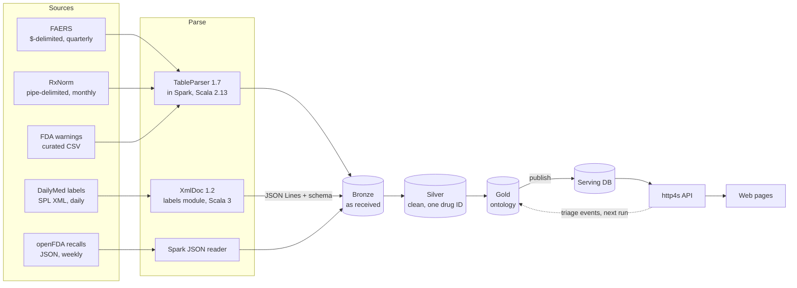

# Architecture

## Data flow

All bronze, silver and gold tables are Delta Lake tables. On a laptop they sit on local disk; the same paths work on object storage.

## Layers

| Layer | Holds | Rules |
|---|---|---|
| Bronze | Each source as received, typed, partitioned by arrival unit (FAERS quarter, label version) | Append only. Nothing is fixed here. Rows that fail to parse go to `rejects` with file, line and reason |
| Silver | Deduplicated cases, resolved drug IDs, normalized labels and recalls | One row per real-world thing. Drug identity is resolved here and nowhere else |
| Gold | The ontology: objects the application and analyses read | One case class per table. Primary keys unique. Links by `rxcui` |
| Serving | Formulary-scoped copies of gold tables in a relational database | Written only by the publish job and the triage endpoint |

## Foundry concepts and their replacements

| Foundry | Here |
|---|---|
| Datasets with transactions | Delta Lake tables: atomic commits, schema enforcement, history |
| Incremental transforms | `run_manifest` watermarks, `MERGE`, partition overwrite |
| Ontology objects and links | Gold tables, Scala case classes, `rxcui` foreign keys |
| Workshop application and actions | http4s API and web pages; triage as an append-only event table |
| Data Health | `run_metrics` table and checks that fail the run |

## Modules

| Module | Scala | Depends on | Notes |
|---|---|---|---|
| `labels` | 3.9 | xmldoc-core, xmldoc-json, circe | Command line tool: label XML in, JSON Lines and schema string out |
| `pipeline` | 2.13 | spark-sql 4.0.x (provided), delta-spark, tableparser-core and tableparser-spark 1.7.2, graphframes, spark-mllib | All Spark jobs |
| `app` | 3.9 | http4s, circe, a JDBC library | Reads the serving database only |

Why three: Spark is published for Scala 2.13 only; XmlDoc needs Scala 3.9; TableParser's Spark support is on its 1.x line for Scala 2.13. The modules never depend on each other's classes. `labels` hands `pipeline` JSON Lines and a schema string generated from the same case class, so the two cannot drift apart. `pipeline` hands `app` database tables.

JDK 21 everywhere.

### Packages in `pipeline`

| Package | Responsibility |
|---|---|
| `common` | Delta helpers, manifest, metrics, `Reject`, config |
| `bronze` | One reader per source |
| `identity` | `drug_xref` resolver |
| `silver` | Deduplication and normalized tables |
| `stats` | Pure statistical functions (no Spark) |
| `signals` | Counts, 2x2 tables, screen and score |
| `labeltext` | Sentence splitting, dictionary, matcher, negation, evaluator |
| `changes` | Change feed |
| `quality` | Checks |
| `backtest` | As-of rebuild and scoring |
| `advanced` | Class effects, interactions, ranking model |
| `publish` | Export to the serving database |
| `run` | Command line entry points |

## How the professor's libraries are used

**TableParser** parses delimited text into case classes and returns a `Try` per row. It reads FAERS (`$`-delimited, header changes across years), RxNorm (pipe-delimited), Medicare Part D, the formulary, the FDA warning answer key and the gold set. For FAERS the row parser runs inside Spark executors over `spark.read.textFile`, the pattern in `tableparser-spark`'s `DatasetMapper`. A `Failure` becomes a row in `rejects`; this is how "no row silently lost" is enforced.

**XmlDoc** parses label XML. Derived extractors map label sections to case classes; `XmlStream` extracts sections without loading whole documents; `GenericElement` handles irregular body content. Its `json` module writes JSON Lines and derives the Spark schema.

Both uses are confirmed by spikes F4 and F5 before the design is fixed; the fallbacks are in the project plan.

## Decisions that matter most

1. **Identity once, in silver.** A single `drug_xref` table over distinct name strings. A fix to a name mapping fixes every downstream table.
2. **Incremental where it is expensive, full where it is cheap.** Parsing, deduplication, identity and label extraction are incremental. Aggregates over clean silver are rebuilt, because that is fast and always correct. A test proves both paths give the same gold tables.
3. **The text step is keyed by label version and extractor version.** A new FAERS quarter never re-reads a label. A rule change re-runs extraction and nothing else.
4. **Serving is separate from Spark.** The app reads a small database and stays up during a rebuild.

## Cadence

| Run | Trigger | Stages |
|---|---|---|
| Daily | New label versions | Label ingest and extraction for new versions; labeled status; change feed; publish |
| Weekly | Recall updates | Recall merge; change feed; publish |
| Quarterly | New FAERS quarter | FAERS parse and merge; identity for new strings; signals; change feed; publish |
| Full | On demand | Everything from raw files |

FAERS changes only quarterly, so most daily changes are recalls and label updates. The app says so.
