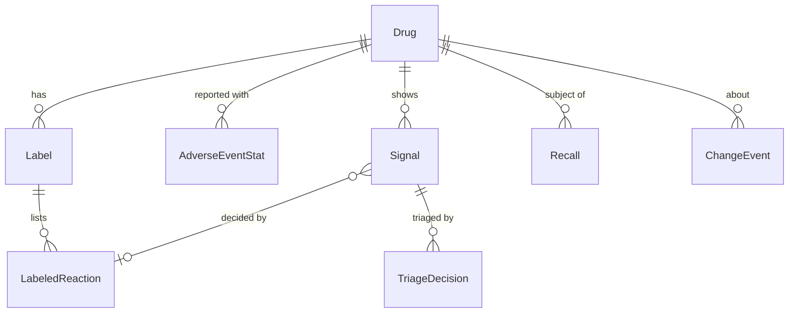

# Ontology (gold layer)

Each object is one Delta table and one Scala case class. Every object links to `Drug` by `rxcui`, the RxNorm ingredient identifier.

## Objects

| Object | Primary key | Fields | Built from |
|---|---|---|---|
| `Drug` | `rxcui` | ingredient name, drug class, on-formulary flag | RxNorm, RxClass, formulary |
| `Label` | `setId`, `version` | `rxcui`, effective date, reference-label flag, section texts | silver `label_version` |
| `LabeledReaction` | `setId`, `version`, `term`, `extractorVersion` | section code, passage, start and end offsets, negated flag | label extraction |
| `AdverseEventStat` | `rxcui`, `term`, `quarter` | case count, serious count, death count, cumulative count | silver case tables |
| `Signal` | `rxcui`, `term` | a, b, c, d counts; PRR; chi-square; odds ratio with 95% interval; score and its components; first-flagged quarter; indication flag; spike flag; labeled status and the deciding `LabeledReaction`; triage status | `AdverseEventStat`, `LabeledReaction`, `TriageDecision` |
| `Recall` | `recallNumber` | `rxcui` (nullable), classification, reason, status, initiation and report dates, product text, source URL | silver `recall` |
| `ChangeEvent` | `runDate`, `kind`, `objectKey` | kind (new signal, signal labeled, label updated, recall opened, recall closed), before and after values | diff of two runs |
| `TriageDecision` | `eventId` | signal key, decision (review, escalate, dismiss), note, user, timestamp | the app; append only |

`AdverseEventStat` is the aggregate form of adverse event reports. Case-level rows stay in silver (`case`, `case_drug`, `case_reaction`) because the application never needs a single report, and aggregates keep the gold layer small.

Objects added in phase 6: `SignalHistory` (signal as of each quarter), `BacktestResult`, `ClassSignal`, `InteractionSignal`, `TrialEvidence`, `Exposure`.

## Operational tables

| Table | Purpose |
|---|---|
| `run_manifest` | Per source: files or versions loaded, checksums, watermark |
| `run_metrics` | Per job run: rows in, out, rejected; duration; newest source date; check results |
| `rejects` | Every input row that failed to parse or validate, with file, line and reason |
| `extraction_score` | Gold-set precision, recall and negation accuracy per extractor version |

## Extending it

To add a source:

1. Add a bronze reader and case class.
2. Map its drug names through `drug_xref` in silver.
3. Add one gold object keyed by `rxcui`.
4. Add it to the publish job if the app needs it.

Nothing existing changes.
